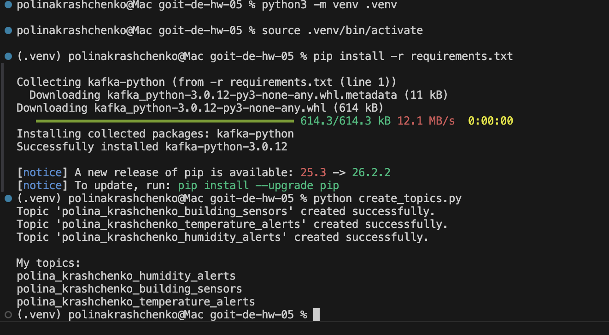
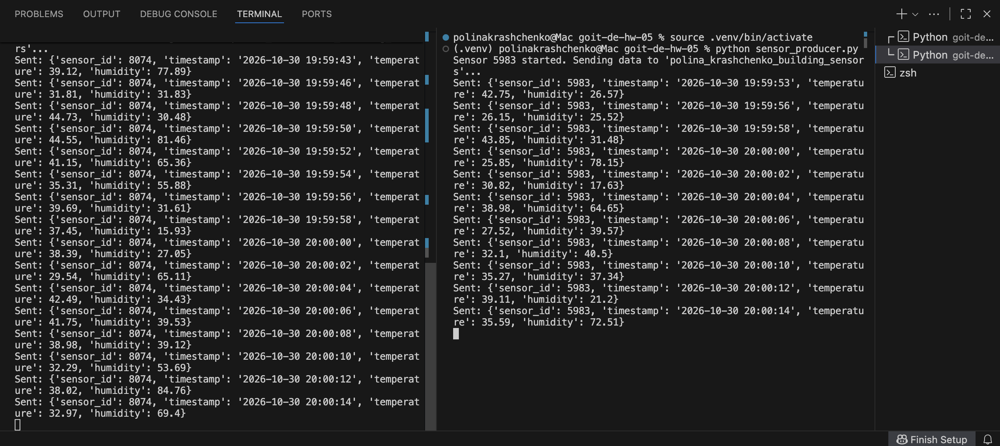
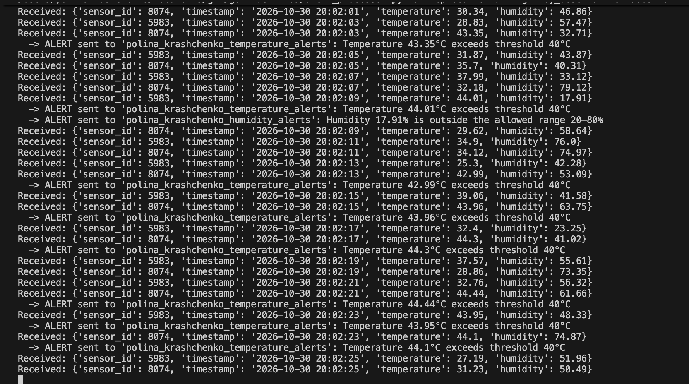
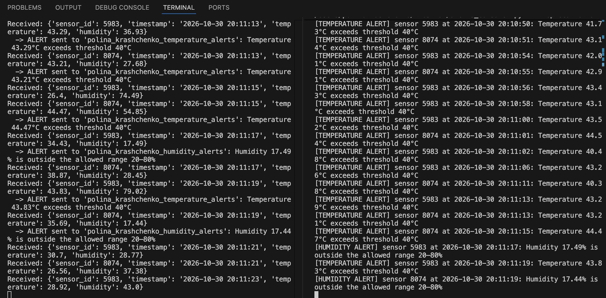
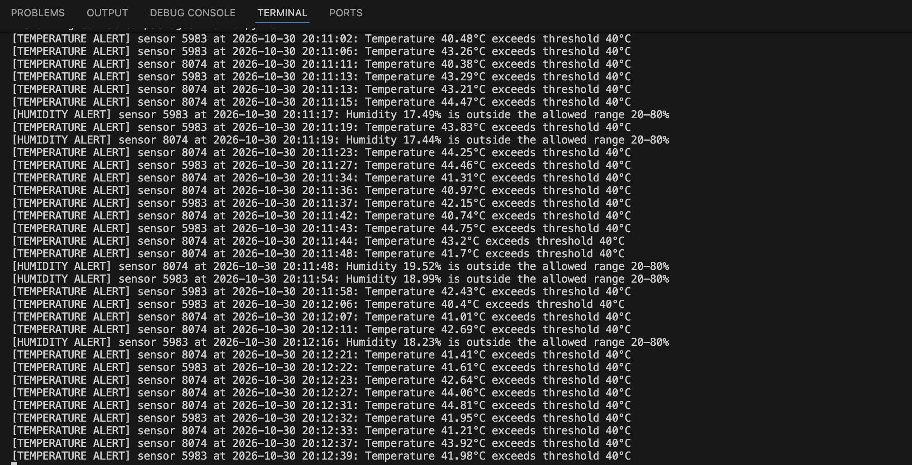

# goit-de-hw-05 — Apache Kafka

Система моніторингу IoT-датчиків: датчики надсилають температуру й вологість у Kafka,
процесор фільтрує дані та формує сповіщення, окремий споживач виводить сповіщення на екран.

## Топіки

| Топік | Призначення |
|---|---|
| `polina_krashchenko_building_sensors` | дані з усіх датчиків |
| `polina_krashchenko_temperature_alerts` | сповіщення: температура > 40 °C |
| `polina_krashchenko_humidity_alerts` | сповіщення: вологість > 80 % або < 20 % |

## Файли

| Файл | Етап |
|---|---|
| `configs.py` | параметри підключення до Kafka та імена топіків |
| `create_topics.py` | 1. створення трьох топіків і виведення їх списку |
| `sensor_producer.py` | 2. імітація одного датчика (ID випадковий і постійний на запуск; температура 25–45, вологість 15–85), відправка кожні 2 с у `building_sensors` |
| `alert_processor.py` | 3–4. читання `building_sensors`, фільтрація та відправка сповіщень у `temperature_alerts` / `humidity_alerts` |
| `alerts_consumer.py` | 5. читання обох топіків сповіщень і виведення на екран |

## Запуск

```bash
python3 -m venv .venv
source .venv/bin/activate
pip install -r requirements.txt

python create_topics.py          # один раз
python sensor_producer.py        # термінал 1 — датчик №1
python sensor_producer.py        # термінал 2 — датчик №2
python alert_processor.py        # термінал 3
python alerts_consumer.py        # термінал 4
```

Зупинка скриптів — `Ctrl+C`.

## Формат повідомлень

Дані датчика:
```json
{"sensor_id": 4821, "timestamp": "2026-10-30 20:15:02", "temperature": 41.37, "humidity": 18.52}
```

Сповіщення:
```json
{"sensor_id": 4821, "timestamp": "2026-10-30 20:15:02", "temperature": 41.37,
 "message": "Temperature 41.37°C exceeds threshold 40°C"}
```

## Скриншоти

### 1. Створення трьох топіків


### 2. Два датчики працюють одночасно (ID 8074 і 5983)


### 3. Отримання даних з building_sensors і фільтрація


### 4. Відфільтровані дані відправлені у temperature_alerts / humidity_alerts
Зліва процесор відправляє сповіщення, справа ті самі сповіщення читаються з топіків.


### 5. Результат: сповіщення з обох топіків

